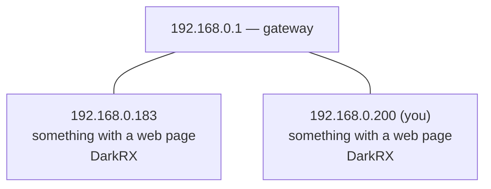

# 06 — Network Topology Mapper

**What it does:** discovers every live device on the LAN, figures out what each one probably is (gateway, computer, printer, IoT...), and draws the network as a tree in the terminal plus a Mermaid diagram for GitHub.

```
Your LAN — 192.168.0.0/24, mapped 2026-11-06 10:32
  192.168.0.1      gateway
  └─ 192.168.0.183   fe:33:db:xx:xx:xx  randomized (privacy MAC)  DarkRX  http,https  (this laptop's enp5s0)  something with a web page
  └─ 192.168.0.200   c8:94:02:xx:xx:xx  unknown  DarkRX  http,https  <- this machine  something with a web page
```

## How it works

Two discovery engines, chosen automatically:

1. **scapy raw ARP sweep** — one broadcast ARP request per address in the subnet, collect replies.
2. **kernel ARP sweep** — a plain UDP "poke" to every address on the discard port, pinned to the target interface with `SO_BINDTODEVICE`. The poke forces the kernel to ARP-resolve the address; results are read back from the neighbour table. Uses the same traffic path as any normal application, so it works everywhere raw injection fails.

If the first engine hears nothing, the tool falls back to the second. Enrichment per host: reverse DNS (1s timeout), a TCP-connect probe of a handful of telltale ports (22/80/443/445/9100), MAC randomization detection (locally-administered bit), and device-role classification. A mapper can never see its own machine through ARP, so the host adds itself explicitly — and if the machine is dual-homed, it admits its sibling interface as a separate node, because that's the truth of the L2 network.

## Why there are two engines: a debugging story

This tool did not work first try, and the failures were the best part:

- **scapy is deaf on this wifi driver.** Injected ARP sweeps over `wlp3s0` returned zero answers, repeatedly, while the kernel's own ARP path on the same radio demonstrably worked (`arping` got instant replies; a packet capture showed the kernel completing a full who-has/is-at exchange in milliseconds). Verdict: raw frame injection/reception is broken on this particular driver in managed mode. Power-save was ruled out manually. Rather than fight it, the kernel became the fallback engine.
- **Dual-homing sabotaged the kernel sweep silently.** With both ethernet and wifi connected, the first kernel sweep *worked* — but every fresh neighbour entry landed on the *other* interface's table, because the kernel routed the UDP pokes however it pleased. The tool printed "nobody answered" while having actually resolved the gateway on a wire it wasn't reading. Fix: `SO_BINDTODEVICE` pins the poking socket to the interface being swept. Lesson: on a dual-homed box, forcing the send path and the read path onto the same interface isn't optional.
- **Parsers must not trust column positions.** An early version read results from `ip neigh` using fixed token indexes; when the output format shifted (the `dev` token vanishing from filtered output), the parser silently discarded the one live entry it had. The shipped parser keys on the `lladdr` keyword instead of positions — format-proof by construction. The failure mode that caught this: an empty result now dumps the raw neighbour table so the next bug announces itself.

## Findings about this LAN

- The router (`192.168.0.1`, `dc:ea:e7:xx:xx:xx`) answers reverse DNS as `devicesetup.net` — ISP branding, which the classifier happily uses as a hint.
- **This laptop wears masks on both interfaces.** The ethernet MAC `fe:33:db:xx:xx:xx` has the locally-administered bit set — NetworkManager randomizes the wired MAC too, not just wifi. Combined with DHCP renewals observed over one morning (`.183` → `.200` on the same radio), the machine has held at least three identities in a few hours.
- That connects directly to project #5's packet captures: the router's periodic poll of ~20+ dead lease addresses (48-second cycle, captured verbatim) is largely a trail of privacy-MAC debris. Devices shedding identities strand leases behind them; the router keeps knocking on graves. Projects #3 (ARP), #5 (sniffing) and #6 (this) tell one story about what MAC randomization does to a home network.
- Phones come and go: the Samsung (`.242`, randomized MAC `12:e9:9e:xx:xx:xx`, reverse DNS `android-phone`) appeared in early sweeps and was absent from the final map — asleep or gone. A topology snapshot is exactly that: a snapshot.

## Usage

```
python -m venv .venv
.venv/bin/pip install -r requirements.txt
sudo .venv/bin/python mapper.py              # auto: scapy sweep, kernel fallback
sudo .venv/bin/python mapper.py --kernel     # kernel engine directly
sudo .venv/bin/python mapper.py --no-probe   # discovery only, skip port probes
sudo .venv/bin/python mapper.py -c 192.168.0.0/24   # sweep an explicit subnet
```

Root is required (raw sockets + `SO_BINDTODEVICE`). The tool follows the default route to select interface, gateway and subnet, so Docker bridges and VPN tunnels can't hijack the sweep.

## Limitations

- Raw scapy injection is broken on this machine's wifi driver; the kernel engine is the reliable path there. Ethernet handles both engines fine.
- Vendor lookup is intentionally minimal: randomized MACs are *labeled* as such rather than guessed at, because a wrong vendor is worse than none.
- Classification is heuristic (port-based). A quiet phone and a NAS with all ports closed look identical.

## The map


